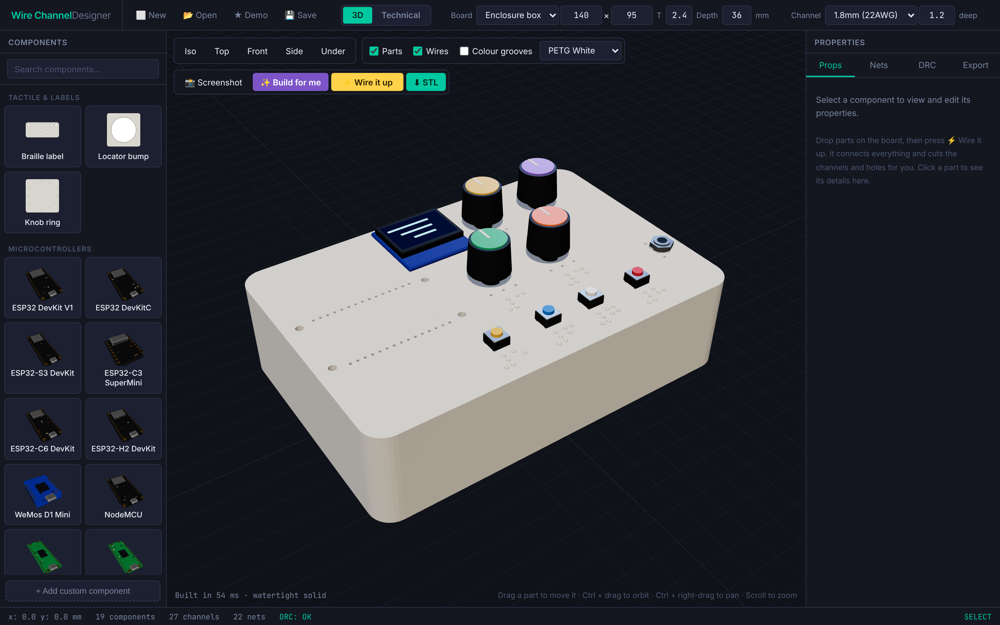
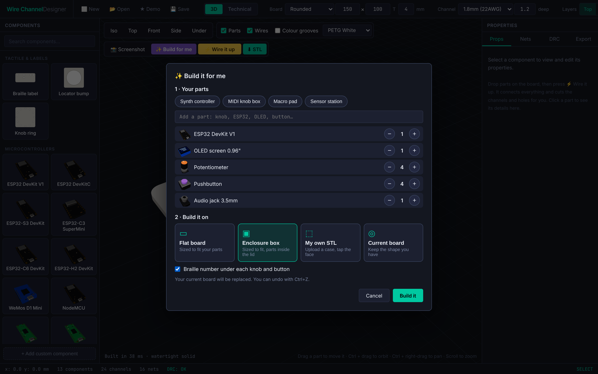
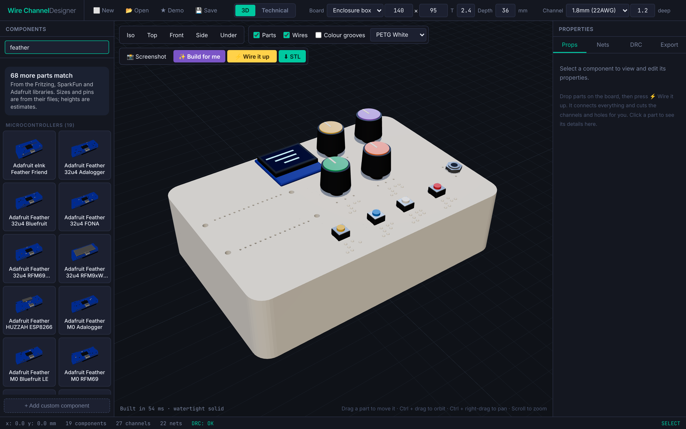
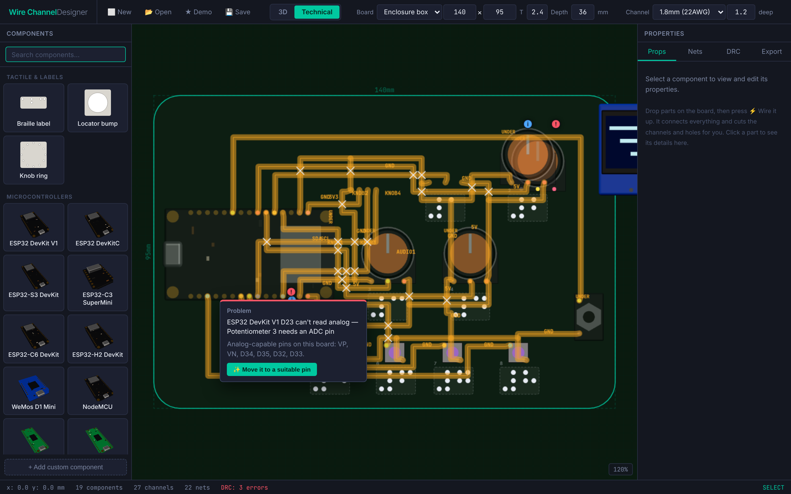

# Wire Channel Designer

**Design 3D-printable circuit boards with grooves for your wires, right in your browser.**
Drop parts on a board (or on any STL you like), auto-route the channels, check it in 3D, and export a watertight STL ready to slice. Then print it, lay hookup wire in the grooves, push the parts through and solder.

**▶ Open the tool:** https://meteteq.github.io/wire-channel-designer

No install, no account, no server. It's one HTML file and works offline.

Inspired by Johan von Konow's 3DPCB method (Print a Synth, 3DPCBoy).

---

## Screenshots

| Build for me | Searching 1,500+ parts | One-tap fixes |
|---|---|---|
|  |  |  |

## What it does

- **1,500+ parts**: 1,369 boards, modules and parts from the Fritzing, SparkFun and Adafruit libraries (search for any of them, or press *Browse more parts*), plus **133 hand-checked parts** with sizes, heights, mounting holes and pin positions: ESP32 (classic, S3, C3, C6, H2), Raspberry Pi Pico / Pico 2, Arduino Uno / Nano / Mega / Pro Micro, STM32 Blue/Black Pill, Teensy 4.1, Pi 4/5/Zero 2, Jetson Orin Nano, BeagleBone, sensors, displays, motor drivers, power modules, ICs, pots, encoders, buttons, jacks and connectors.
- **Any shape**: rectangle, rounded, circle, triangle, hexagon, a ready-made **enclosure box**, or **import your own STL** (a box from Thingiverse, a synth case…) and tap the face you want the parts on.
- **⚡ Wire it up**: drop your parts on and press one button. It picks sensible pins on the microcontroller, cuts every channel and drops the holes in.
- **✨ Build for me**: list your parts (or pick a preset like Synth controller or Macro pad), choose a flat board, an **auto-sized enclosure** or your own STL, and the tool places, wires and sizes everything. Optional Braille numbers under each control.
- **Fix it / Fix all**: every warning comes with a tip and a one-tap fix (move a part, widen a gap, rewire a net, add a missing resistor, re-lay the board).
- **Crossovers**: when two channels have to cross, one insulated wire is laid over the other, marked ✕, so you rarely need the underside.
- **Two-face auto-router**: channels avoid holes, keep apart from other signals and hop to the underside through a via when they'd otherwise cross.
- **Pin-aware**: give each pin a net in Props. Power, ground, I²C and SPI pins connect themselves.
- **📌 Pinout reference** for every part: what each pin can do (ADC, PWM, I²C, input-only, boot pins), plus warnings about common gotchas like ESP32 ADC2 + WiFi.
- **Warning flags on the board**: red = must fix, orange = check, blue = tip. Catches pots on non-analog pins, 3V3 tied to 5V, shorts, holes colliding, parts off the board, knobs too close to turn, sockets away from the edge, and unrouted connections. Tap a flag to see why and how to fix it.
- **3D view like Tinkercad**: drag to move parts, Ctrl+left-drag to orbit, Ctrl+right-drag to pan (one finger orbits on touch, two fingers zoom and pan), scroll or pinch to zoom, with Iso/Top/Front/Side/Under views and parts modelled at real size. Pick a filament colour and grab a screenshot.
- **Tactile & accessible**: Grade 1 **Braille labels** (standard 1.5 mm dots, 2.5 mm spacing), tactile locator bumps, and knob locator rings, all printed as part of the board.
- **Panel mounting**: parts can sit under the panel (inside an enclosure) with shaft holes cut for pots, encoders, jacks and toggles.
- **Exports**: STL (watertight, using the [Manifold](https://github.com/elalish/manifold) geometry engine), OpenSCAD source, 3D render PNG, BOM CSV with suggested part numbers, wiring legend SVG, and layout JSON (save/open).
- **Works on phones**: tap a part to add it, with Parts/Props drawers and touch controls in 3D.

## Quick start

1. Open the tool. A demo ESP32 synth controller loads, and a short tour explains the basics.
2. Pick a **Board** shape (or **Import STL…**).
3. Drag or tap parts from the left panel (hover one to see its size and pins). In 3D, drag parts around the board. **Ctrl + drag** orbits, **Ctrl + right-drag** pans, and scroll zooms. On touch screens, drag a part to move it, drag empty space to orbit, and use two fingers to pan and zoom.
4. Press **⚡ Wire it up**. It connects every part to your microcontroller on sensible pins, then cuts the channels and the holes for every leg.
5. Fix any flags. For hand-picked pins, select a part → **Props** → **Pins**, or switch to the **Technical** view.
6. **⬇ STL** to download.

### Printing tips
- Print a small test first and check your parts' legs fit the **1.0 mm pin holes** (change it under Export → Pin hole Ø).
- PETG, 0.2 mm layers, flat face down. Channels default to 1.8 mm wide × 1.2 mm deep for 22 AWG.
- Keep at least 0.8 mm of plastic under a channel. The tool warns you if you don't.

## Help the library grow

Every part has a **"Pinout wrong or missing? Report it"** link that opens a pre-filled issue here. See [CONTRIBUTING.md](CONTRIBUTING.md) to fix pinouts or add parts yourself.

## Credits

The extra parts come from the Fritzing, SparkFun and Adafruit part libraries (CC BY-SA). See [CREDITS.md](CREDITS.md).

## Built with

[three.js](https://threejs.org) (3D), [Manifold](https://github.com/elalish/manifold) (watertight booleans), [three-bvh-csg](https://github.com/gkjohnson/three-bvh-csg) (fallback booleans), all MIT/Apache licensed and bundled into the page so it runs offline.

## License

MIT. Use it, fork it, sell things you make with it. Credit appreciated.

Made by Kris / Cerebral Meltdown Records.

## Support

Wire Channel Designer is free and always will be. If it saved you time, you can [buy me a coffee](https://buymeacoffee.com/metet). It helps me keep adding parts and features.
